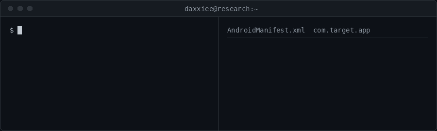
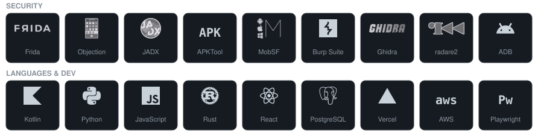

Bug bounty hunter · Reverse engineering · Mobile application security

 

## About Me

- 🔭 **Currently working on:** Local Code Workspace
- 🌱 **Currently learning:** Cyber Security
- 🎯 **Focus:** Android app security, web security, penetration testing
- 💬 **Ask me about:** Deep links, intent/WebView exploitation, OAuth/PKCE flows
- 🏴 **Platforms:** Intigriti (`daxxiee0_`) · Bugcrowd

 

## Stats

 

## Tech Stack

 

## Research Highlights

| Target | Platform | Finding |
|:--|:--|:--|
| Okta Verify (Android) | Bugcrowd | `UriEnrollmentActivity` deep link (`oktaverify://`) registered BROWSABLE without `autoVerify`, so any web page can trigger enrollment · **P3** |
| Capital.com (Android) | Intigriti | Hardcoded OAuth client secret in production APK, confirmed via live token retrieval · PKCE-absent auth code interception chain, validated with a Kotlin PoC |
| Dropbox (Android) | Intigriti | Exported `FileCacheProvider` (CWE-284, CVSS 6.8 High), validated with a Kotlin PoC |
| Canva (Android) | Bugcrowd | Frida instrumentation research, including dynamic overload resolution for obfuscated methods |

 

## Approach

Static analysis (JADX, APKTool, Smali) → dynamic instrumentation (Frida, Objection) → full taint flow tracing from source to sink across every trust boundary. A finding is only a finding once it is reachable and demonstrated.

 

Stay curious. Verify everything.

